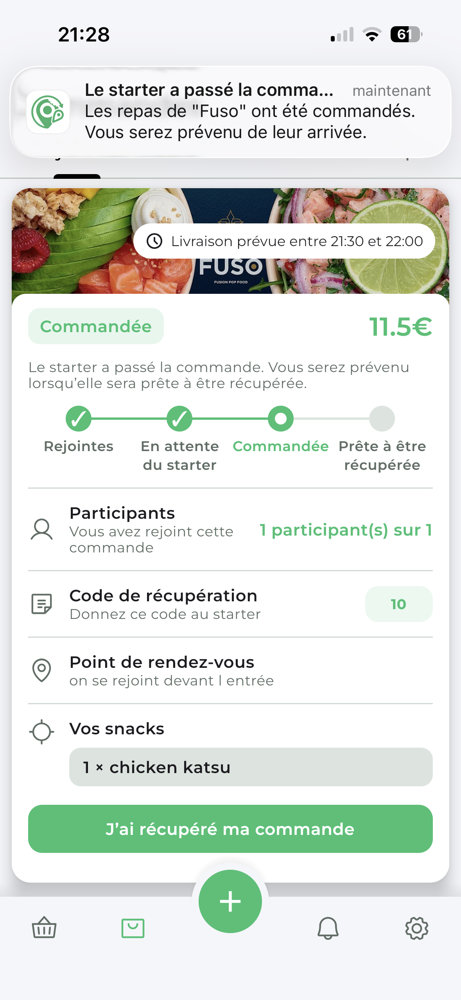
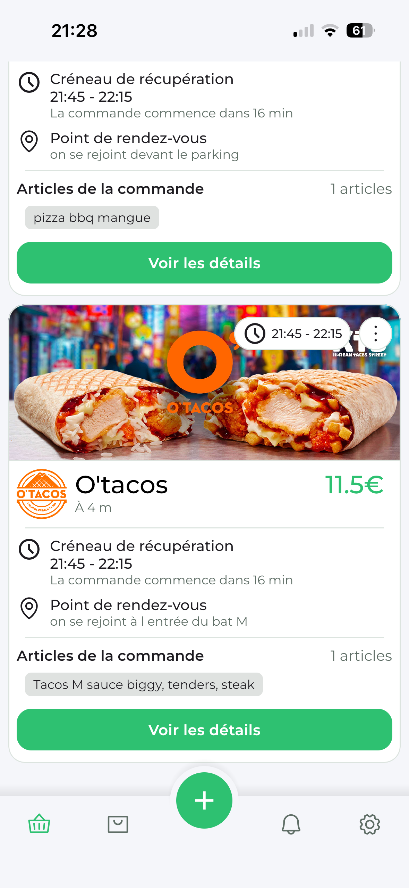
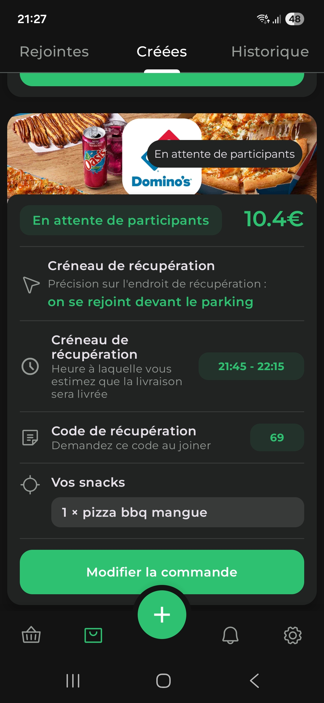
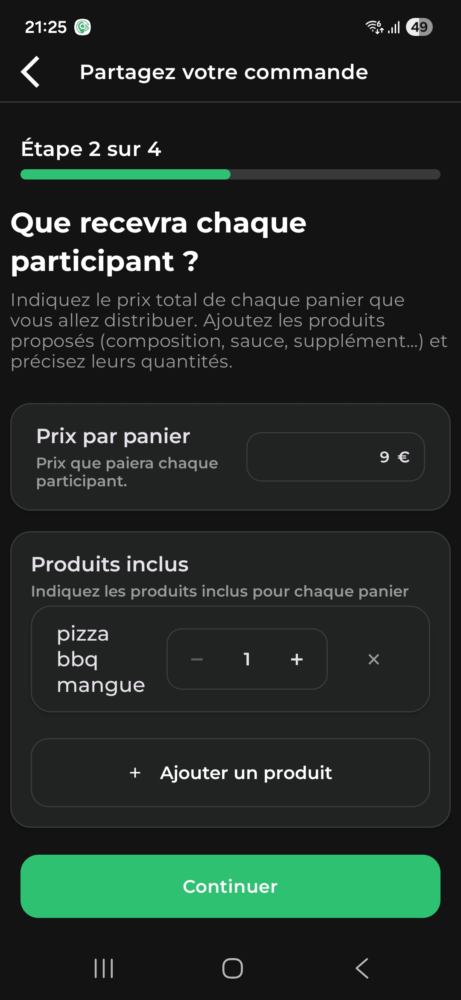
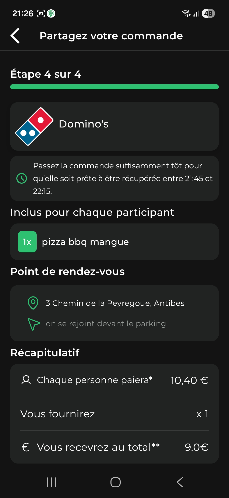

# Croquo — Commandes de repas groupées

**Application mobile Android et iOS permettant d’organiser et de rejoindre des commandes de repas entre personnes à proximité.**

Croquo facilite la mutualisation des livraisons : une personne organise une commande auprès d’un restaurant, d’autres utilisateurs proches la rejoignent, puis chacun récupère son repas au point de rendez-vous prévu.

Ce dépôt présente le fonctionnement de l’application, son architecture et les principaux défis techniques du projet. Le code source de l’application et du serveur reste privé.

**[Voir la démonstration — lien à ajouter]**

## Aperçu

| Android | iOS |
|---|---|
|  |  |

## Comment fonctionne Croquo ?

L’application distingue deux rôles :

- **Le starter** crée et organise la commande collective.
- **Le participant** rejoint une commande pour obtenir son repas.

Le parcours se déroule en plusieurs étapes :

1. Le starter choisit un restaurant et renseigne le repas proposé, son prix, le nombre de places, l’heure et le point de rendez-vous.
2. Les utilisateurs à proximité découvrent la commande et peuvent la rejoindre. Leur paiement est autorisé lors de la participation.
3. Le starter suit les participations et indique l’avancement de la commande.
4. Lorsque les repas sont arrivés, les participants reçoivent une notification les invitant au point de rendez-vous.
5. La réception du repas est confirmée et le paiement est finalisé. Des mécanismes d’annulation, de signalement et de confirmation automatique encadrent les situations particulières.

Le starter utilise Stripe Connect pour recevoir les paiements liés aux participations.

## Fonctionnalités principales

- **Découverte locale** : consultation des commandes disponibles à proximité.
- **Création de commandes** : restaurant, repas, prix, capacité et point de rendez-vous.
- **Participation** : rejoindre une commande et suivre son avancement.
- **Paiement intégré** : autorisation, capture, annulation et remboursement selon l’état de la participation.
- **Suivi en temps réel** : actualisation des statuts par WebSocket.
- **Notifications** : informations sur les participations et les étapes de la commande.
- **Historique** : consultation des commandes créées et rejointes.
- **Gestion du compte** : connexion, vérification du téléphone et suppression du compte.
- **Internationalisation** : interface en français et en anglais.

## Mon travail sur le projet

Le projet couvre plusieurs aspects du développement d’un produit mobile :

- Conception des parcours et de l’interface.
- Développement mobile Android et iOS.
- Développement de l’API et des règles métier.
- Modélisation de la base de données.
- Intégration des paiements et des notifications.
- Conteneurisation et déploiement du serveur.
- Tests, diagnostic et correction des problèmes rencontrés sur appareils réels.

## Stack technique

| Domaine | Technologies | Utilisation |
|---|---|---|
| Mobile | Kotlin, Compose Multiplatform | Interface et code partagé entre Android et iOS |
| Architecture mobile | MVVM, coroutines, Flow | Gestion des états et des traitements asynchrones |
| Serveur | Kotlin, Ktor | API HTTP, authentification et WebSocket |
| Données | PostgreSQL, PostGIS, Exposed | Persistance et recherche géographique |
| Paiements | Stripe, Stripe Connect | Paiements des participants et comptes des starters |
| Notifications | Firebase Cloud Messaging, APNs | Notifications sur Android et iOS |
| Authentification | JWT, Google Sign-In, Sign in with Apple | Accès aux comptes et aux routes protégées |
| Vérification téléphonique | SMS OTP via OVHcloud | Vérification du numéro de téléphone |
| Géolocalisation | GPS, API IGN / Géoplateforme | Adresses et établissements proches |
| Images | Cloudflare R2 | Stockage privé et accès par liens temporaires |
| Déploiement | Docker, Caddy, VPS | Exécution du serveur et accès HTTPS |
| Livraison serveur | GitHub Actions, GHCR | Vérification et publication de l’image Docker |

## Architecture

L’application mobile communique avec une API Ktor qui porte les règles métier et contrôle les accès aux données.

- **Le client mobile** affiche les commandes, collecte les actions de l’utilisateur et observe les changements de statut.
- **Le serveur** vérifie les autorisations, applique les transitions de statut et coordonne les services externes.
- **PostgreSQL et PostGIS** stockent les utilisateurs, commandes, participations et informations géographiques.
- **Stripe** traite les paiements et informe le serveur de leur évolution par webhook.
- **FCM et APNs** permettent d’informer les utilisateurs même lorsque l’application n’est pas au premier plan.
- **R2** sert les images au moyen d’URL temporaires générées par le serveur.

Le code partagé est complété par des intégrations spécifiques aux plateformes lorsque cela est nécessaire, notamment pour l’authentification, les notifications et certaines interactions natives.

## Défis techniques

### Maintenir la cohérence entre commandes et paiements

Une commande collective et la participation d’un utilisateur possèdent des états distincts. Leur évolution doit rester cohérente avec celle du paiement, y compris lors d’une annulation ou d’un remboursement.

L’intégration s’appuie sur des validations côté serveur, les webhooks Stripe et des opérations idempotentes pour gérer les nouvelles tentatives sans répéter leurs effets.

### Gérer les événements asynchrones

Les événements de paiement peuvent être reçus plusieurs fois ou dans un ordre différent de celui attendu.

Le serveur doit reconnaître les événements déjà traités, tenir compte des états finaux et permettre la reprise des opérations qui n’ont pas abouti.

### Partager le code sans négliger les plateformes

Compose Multiplatform permet de partager une grande partie de l’interface et de la logique mobile. Les différences Android et iOS nécessitent toutefois une attention particulière : clavier, autorisations, cycle de vie, connexion et notifications.

Les parcours sont vérifiés sur un téléphone Android et un iPhone pour identifier ces différences.

### Actualiser les commandes en temps réel

Le suivi par WebSocket complète les requêtes HTTP pour afficher les changements de statut sans demander systématiquement un rafraîchissement manuel.

Le fonctionnement doit aussi prendre en compte les interruptions réseau et le retour de l’application au premier plan.

### Servir des images avec des liens temporaires

Les images sont stockées dans un bucket R2 privé. Le serveur fournit des liens à durée limitée et le client peut renouveler ceux qui ont expiré.

Cette approche limite l’exposition permanente des fichiers tout en conservant leur affichage dans l’application.

## Tests et validation

Les vérifications couvrent notamment :

- La création et la participation à une commande.
- Les changements de statut et leur affichage.
- Les paiements, annulations et remboursements.
- La réception des notifications Android et iOS.
- Les permissions de localisation et les retours sur l’application.
- Le renouvellement des liens d’images expirés.

[Ajouter ici les commandes de tests, les scénarios automatisés et leurs résultats vérifiables.]

## État du projet

- Test fermés

Ce dépôt est consacré à la présentation du projet. Il ne contient pas de version exécutable du serveur ni d’identifiants permettant d’accéder à son infrastructure.

## Contact

**[https://www.linkedin.com/in/martin-risch-19377138a/]**
    
